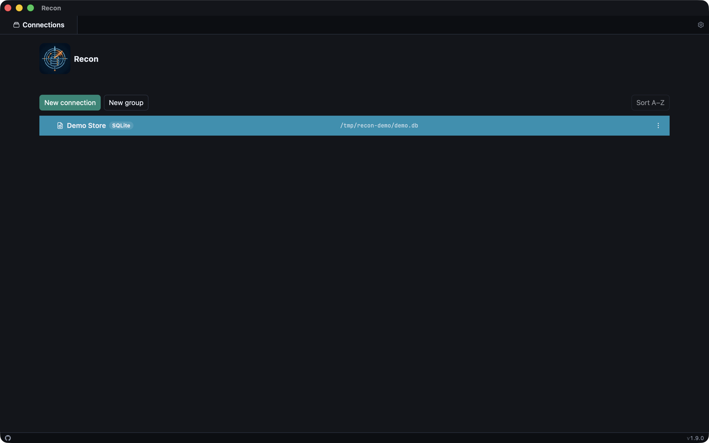
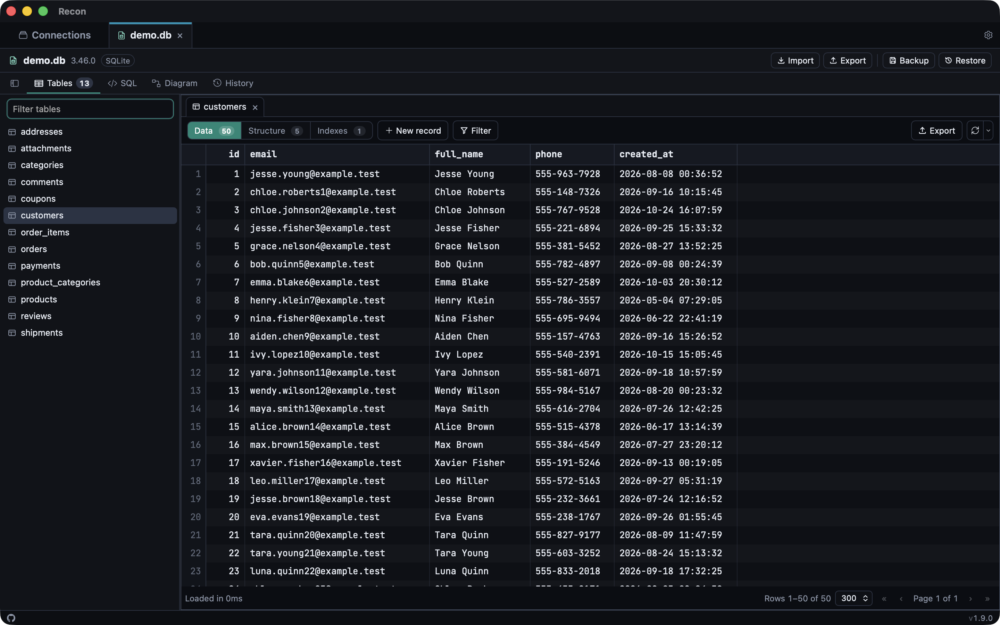
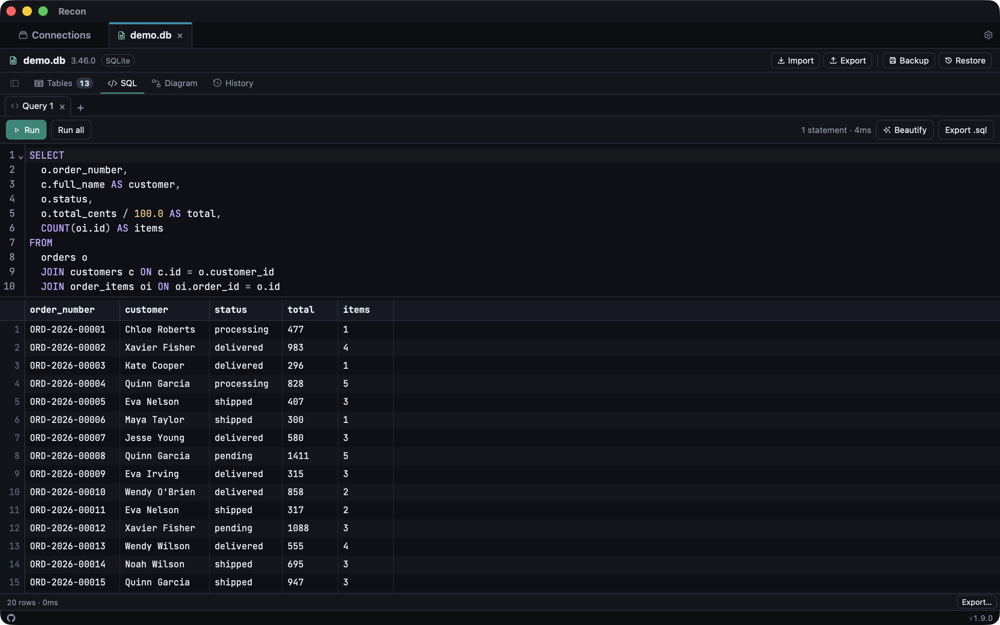
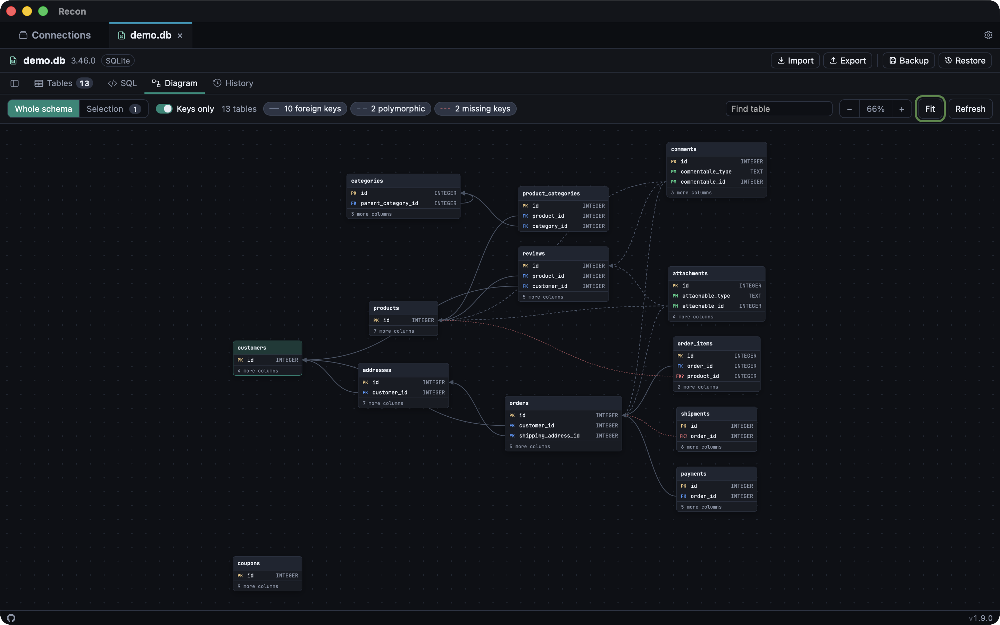
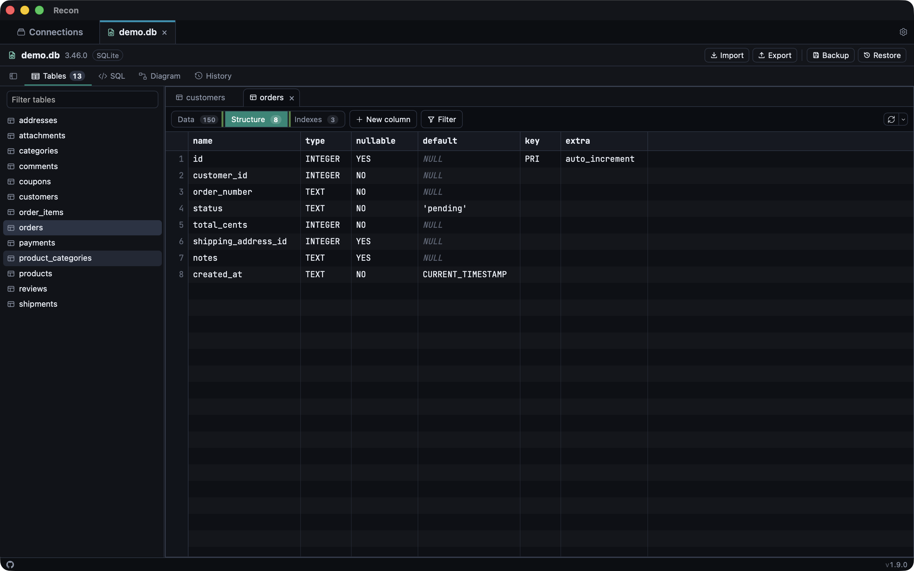
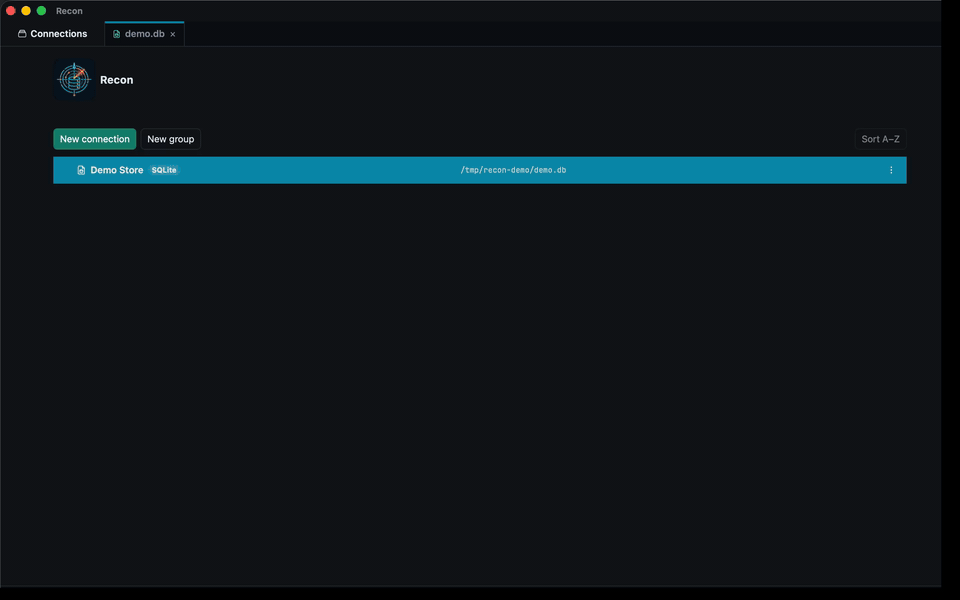

<p align="center">
  
</p>

<h1 align="center">Recon</h1>

<p align="center">
  A local-first database client for macOS, Windows, and Linux. Connect to MySQL, PostgreSQL, and SQLite with built-in drivers—no additional software required. Your credentials stay secure in the macOS Keychain, Windows Credential Manager, or the Linux system keyring.
</p>

<p align="center">
  <a href="https://github.com/fylzero/recon/releases/latest/download/Recon-macos-arm64.dmg"></a>
  <a href="https://github.com/fylzero/recon/releases/latest/download/Recon-windows-x64.exe"></a>
  <a href="https://github.com/fylzero/recon/releases/latest/download/Recon-linux-x64.AppImage"></a>
  <a href="https://buymeacoffee.com/fylzero1"></a>
</p>

<p align="center">
  Windows on ARM:
  <a href="https://github.com/fylzero/recon/releases/latest/download/Recon-windows-arm64.exe">installer</a>
  <br>
  Other Linux downloads:
  <a href="https://github.com/fylzero/recon/releases/latest/download/Recon-linux-x64.deb">.deb</a> ·
  <a href="https://github.com/fylzero/recon/releases/latest/download/Recon-linux-x64.rpm">.rpm</a> ·
  ARM64 <a href="https://github.com/fylzero/recon/releases/latest/download/Recon-linux-arm64.AppImage">AppImage</a>,
  <a href="https://github.com/fylzero/recon/releases/latest/download/Recon-linux-arm64.deb">.deb</a>,
  <a href="https://github.com/fylzero/recon/releases/latest/download/Recon-linux-arm64.rpm">.rpm</a>
</p>

## About

Recon is an open-source database client for macOS, Windows, and Linux, built with Tauri, Vue, and Rust. It works with MySQL, PostgreSQL, and SQLite databases without separate database drivers or command-line tools.

**Key characteristics:**

- **Open source**: Free to use and modify under the MIT license
- **Privacy-focused**: Database credentials stored exclusively in the macOS Keychain, Windows Credential Manager, or the Linux system keyring
- **No external dependencies**: MySQL, PostgreSQL, and SQLite drivers compiled directly into the app
- **Local-first**: All connections and queries run locally on your machine
- **Native app**: A Tauri shell with a Rust backend, not a bundled browser

## Features

**Connection Management**
- Multiple database connections with organized grouping
- Secure password storage in the macOS Keychain, Windows Credential Manager, or the Linux system keyring
- SSH tunnel support for remote databases
- SSL/TLS encryption for MySQL and PostgreSQL
- AWS IAM authentication support
- Connection testing before saving

**Data Browsing & Editing**
- Browse tables with filtering, sorting, and pagination
- Visual filter builder with support for complex conditions
- Edit cells inline with immediate feedback
- Insert, update, and delete rows
- Find and replace across table data
- Copy data in multiple formats

**Query Editor**
- SQL syntax highlighting with CodeMirror
- Execute multiple statements in sequence
- Query history tracking
- Save and organize frequently used queries
- View query execution time and row counts

**Schema Management**
- View and edit table structure (columns, indexes, foreign keys)
- Visual schema diagrams showing table relationships
- Create, rename, and drop databases/schemas
- Create and modify tables
- Add and alter columns and indexes
- Truncate and drop tables

**Data Import & Export**
- Export tables to SQL, CSV, or JSON formats
- Import data from SQL, CSV, or JSON files
- Backup and restore entire databases
- Export filtered data or entire tables
- Row-level import and export options

**Database Support**
- **MySQL / MariaDB**: Full support with SSL/TLS
- **PostgreSQL**: Complete feature set with SSL/TLS
- **SQLite**: Local database file support with ability to create new databases

## Download & Installation

### macOS (Apple Silicon)

Download the latest release:

**[⬇️ Download Recon for macOS (Apple Silicon)](https://github.com/fylzero/recon/releases/latest/download/Recon-macos-arm64.dmg)**

Current macOS builds are **Apple Silicon only**. Releases are signed with a Developer ID certificate and notarized by Apple.

### Windows (x64 and ARM64)

**[⬇️ Download Recon for Windows (x64)](https://github.com/fylzero/recon/releases/latest/download/Recon-windows-x64.exe)**

Run the installer. It installs Recon for your user account without asking for administrator rights, and **Help → Check for Updates…** keeps it current. On ARM PCs, like Snapdragon laptops, use [Recon-windows-arm64.exe](https://github.com/fylzero/recon/releases/latest/download/Recon-windows-arm64.exe) instead.

The installer isn't code-signed yet, so Windows SmartScreen may say **Windows protected your PC**. Click **More info**, then **Run anyway**.

Saved passwords go to Windows Credential Manager. SSH tunnels through a ProxyJump or ProxyCommand host use Windows' built-in OpenSSH client, which Windows 10 and 11 install by default, and password commands run in `cmd`.

### Linux (x64 and ARM64)

**[⬇️ Download Recon for Linux (AppImage, x64)](https://github.com/fylzero/recon/releases/latest/download/Recon-linux-x64.AppImage)**

Pick one package. Each one updates itself from **Help → Check for Updates…**; the `.deb` and `.rpm` ask for your password to install the update.

| Package | Install |
| --- | --- |
| [AppImage](https://github.com/fylzero/recon/releases/latest/download/Recon-linux-x64.AppImage) (any distro) | `chmod +x Recon-linux-x64.AppImage`, then run it |
| [.deb](https://github.com/fylzero/recon/releases/latest/download/Recon-linux-x64.deb) (Debian, Ubuntu, Mint) | `sudo apt install ./Recon-linux-x64.deb` |
| [.rpm](https://github.com/fylzero/recon/releases/latest/download/Recon-linux-x64.rpm) (Fedora, RHEL, openSUSE) | `sudo dnf install ./Recon-linux-x64.rpm` |

Use the `arm64` files on ARM machines. Recon needs WebKitGTK 4.1, which the `.deb` and `.rpm` install for you and Ubuntu 22.04, Debian 12, Fedora 36, and newer include.

Saved passwords go to the Secret Service keyring, which GNOME Keyring and KDE Wallet both provide. On a desktop without one, turn off **Save password** and Recon asks for the password each time you connect.

SSH tunnels use `/usr/bin/ssh` and HTTPS certificate downloads use `/usr/bin/curl`, so install `openssh-client` and `curl` if your distro leaves them out.

## Screenshots

### Connection Dashboard

<p align="center">
  
</p>

Organize database connections into groups with custom colors. All credentials are stored securely in the macOS Keychain, Windows Credential Manager, or the Linux system keyring.

### Table Browser

<p align="center">
  
</p>

Browse table data with filtering, sorting, and inline editing. The visual filter builder supports complex conditions without writing SQL.

### Query Editor

<p align="center">
  
</p>

Write and execute SQL queries with syntax highlighting, execution time tracking, and result previews.

### Schema Diagram

<p align="center">
  
</p>

Visualize table relationships with automatic foreign key detection, polymorphic relationship support, and missing foreign key suggestions.

### Table Structure

<p align="center">
  
</p>

Inspect and modify table structure including columns, data types, indexes, and foreign key constraints.

### Demo

<p align="center">
  
</p>

## Development

Recon is built with [Tauri](https://v2.tauri.app/)—a Vue.js frontend with a Rust native backend. To build and run from source, you'll need **Bun**, **Rust**, and a C toolchain: **Xcode Command Line Tools** on macOS, the **Visual Studio Build Tools** on Windows, or the **WebKitGTK** development packages on Linux.

### Prerequisites

#### 1. Clone the repository

```bash
git clone https://github.com/fylzero/recon.git
cd recon
```

#### 2. Native build tools

**macOS:** Xcode Command Line Tools provide the C/C++ compiler that Rust uses.

```bash
xcode-select --install
```

If they're already installed, confirm with:

```bash
xcode-select -p
```

**Linux:** install a compiler, WebKitGTK, and the D-Bus headers the keyring uses. On Debian or Ubuntu:

```bash
sudo apt install build-essential curl libwebkit2gtk-4.1-dev libxdo-dev libssl-dev librsvg2-dev libayatana-appindicator3-dev libdbus-1-dev pkg-config
```

For Fedora, Arch, and other distros, see [Tauri's Linux prerequisites](https://v2.tauri.app/start/prerequisites/#linux) and add the D-Bus development package (`dbus-devel` on Fedora, `dbus` on Arch).

**Windows:** install the [Build Tools for Visual Studio](https://visualstudio.microsoft.com/visual-cpp-build-tools/) with the **Desktop development with C++** workload. See [Tauri's Windows prerequisites](https://v2.tauri.app/start/prerequisites/#windows) for details. WebView2 already comes with Windows 10 and 11.

#### 3. Bun

Install using the official script from [bun.sh](https://bun.sh/):

```bash
curl -fsSL https://bun.sh/install | bash
bun --version
```

On Windows, run `powershell -c "irm bun.sh/install.ps1 | iex"` instead.

#### 4. Rust

Tauri compiles the native app with `cargo`. Install the official toolchain with [rustup](https://www.rust-lang.org/tools/install):

```bash
curl --proto '=https' --tlsv1.2 -sSf https://sh.rustup.rs | sh
```

On Windows, download and run `rustup-init.exe` from the same page and keep the default MSVC toolchain.

Accept the defaults, then **open a new terminal** and confirm:

```bash
cargo --version
```

`bun run tauri dev` already prepends `$HOME/.cargo/bin` to `PATH`.

### Running in development

```bash
bun install
bun run tauri dev
```

On Windows, run `bunx tauri dev` instead. The `tauri` script sets `PATH` the Unix way, which doesn't work there.

This command:

1. Starts Vite on `http://localhost:1420` for the Vue UI
2. Compiles the Rust/Tauri backend
3. Opens the native Recon window with hot-reload enabled

**Note**: The **first** `tauri dev` (or `tauri build`) downloads crates and compiles from scratch, including the MySQL, PostgreSQL, and SQLite drivers. This often takes several minutes. Subsequent runs are much faster.

### Building a release

Build a production app bundle:

```bash
bun run tauri build
```

On macOS, the build produces:

| Artifact | Path |
| --- | --- |
| App bundle | `src-tauri/target/release/bundle/macos/Recon.app` |
| Disk image | `src-tauri/target/release/bundle/dmg/Recon_<version>_aarch64.dmg` |

Local builds are ad-hoc signed unless an Apple identity is supplied, so macOS Gatekeeper may warn that the app is unidentified. Right-click the app, choose **Open**, then confirm.

On Linux, the build produces:

| Artifact | Path |
| --- | --- |
| AppImage | `src-tauri/target/release/bundle/appimage/Recon_<version>_amd64.AppImage` |
| Debian package | `src-tauri/target/release/bundle/deb/Recon_<version>_amd64.deb` |
| RPM package | `src-tauri/target/release/bundle/rpm/Recon-<version>-1.x86_64.rpm` |

On Windows, `bunx tauri build` produces:

| Artifact | Path |
| --- | --- |
| Installer | `src-tauri/target/release/bundle/nsis/Recon_<version>_x64-setup.exe` |
| MSI package | `src-tauri/target/release/bundle/msi/Recon_<version>_x64_en-US.msi` |

### Running tests

The Rust backend includes unit tests:

```bash
cd src-tauri
cargo test
```

Type checking for the Vue frontend:

```bash
bunx vue-tsc --noEmit
```

### Troubleshooting

**`failed to run 'cargo metadata' ... No such file or directory (os error 2)`**  
Rust is not installed. Run step 4, open a new terminal, and confirm `command -v cargo` prints `/Users/<you>/.cargo/bin/cargo`.

**`xcrun: error: invalid active developer path`**  
Xcode Command Line Tools are missing or stale. Run `xcode-select --install`.

**`The system library 'webkit2gtk-4.1' required by crate 'webkit2gtk-sys' was not found`** (Linux)  
The WebKitGTK development package is missing. Install the Linux packages from step 2.

**`Could not save the password to the system keyring`** (Linux)  
No Secret Service is running. Install and unlock GNOME Keyring or KDE Wallet, or turn off **Save password** so Recon asks each time.

**Frontend only (browser, no native APIs)**  
`bun run dev` serves the Vue app at `http://localhost:1420`. Database connections, dialogs, and other Tauri APIs require `bun run tauri dev`.

## Publishing signed releases

Pushing a `v*` tag runs the Release workflow. It builds and notarizes the macOS app first, then builds the Linux x64 and ARM64 packages, then the Windows x64 and ARM64 installers, and adds them all to the same GitHub release.

See [macOS release setup](docs/macos-releases.md) for Apple Developer enrollment, repository secrets, and the code signing and notarization process, [Linux releases](docs/linux-releases.md) for the Linux packages and how they update, and [Windows releases](docs/windows-releases.md) for the Windows installers and code signing.

## Contributing

See [CONTRIBUTING.md](CONTRIBUTING.md) for code style, required checks, and how to submit issues and pull requests.

## License

MIT License - see [LICENSE](LICENSE) for details.

Copyright (c) 2026 RazorKode LLC
