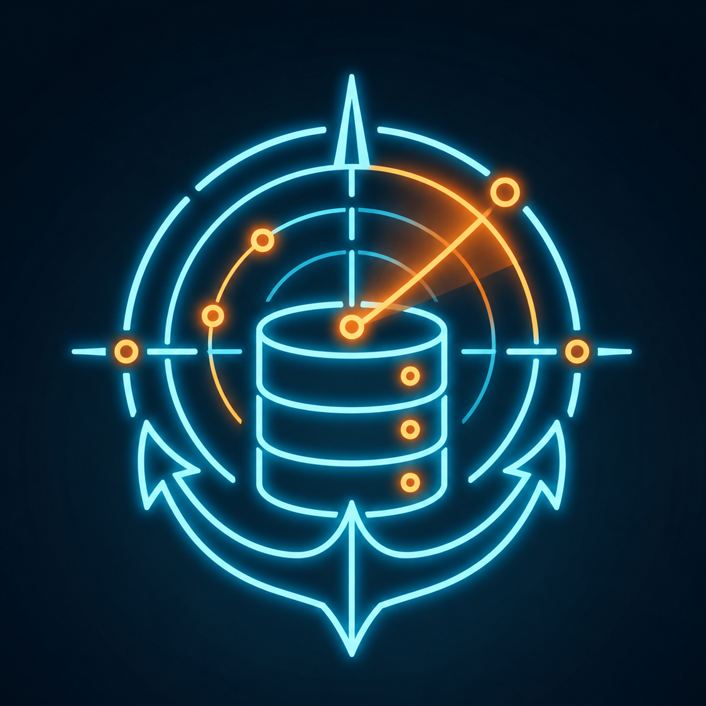

<p align="center">
  
</p>

<h1 align="center">Recon</h1>

<p align="center">
  A local-first database client for macOS. Connect to MySQL, PostgreSQL, and SQLite with built-in drivers—no additional software required. Your credentials stay secure in the macOS Keychain.
</p>

<p align="center">
  <a href="https://github.com/fylzero/recon/releases/latest/download/Recon-macos-arm64.dmg"></a>
  <a href="https://buymeacoffee.com/fylzero1"></a>
</p>

## About

Recon is an open-source database client for macOS, built with Tauri, Vue, and Rust. It works with MySQL, PostgreSQL, and SQLite databases without separate database drivers or command-line tools.

**Key characteristics:**

- **Open source**: Free to use and modify under the MIT license
- **Privacy-focused**: Database credentials stored exclusively in the macOS Keychain
- **No external dependencies**: MySQL, PostgreSQL, and SQLite drivers compiled directly into the app
- **Local-first**: All connections and queries run locally on your machine
- **Native app**: A Tauri shell with a Rust backend, not a bundled browser

## Features

**Connection Management**
- Multiple database connections with organized grouping
- Secure password storage in macOS Keychain
- SSH tunnel support for remote databases
- SSL/TLS encryption for MySQL and PostgreSQL
- AWS IAM authentication support
- Connection testing before saving

**Data Browsing & Editing**
- Browse tables with filtering, sorting, and pagination
- Visual filter builder with support for complex conditions
- Edit cells inline with immediate feedback
- Insert, update, and delete rows
- Find and replace across table data
- Copy data in multiple formats

**Query Editor**
- SQL syntax highlighting with CodeMirror
- Execute multiple statements in sequence
- Query history tracking
- Save and organize frequently used queries
- View query execution time and row counts

**Schema Management**
- View and edit table structure (columns, indexes, foreign keys)
- Visual schema diagrams showing table relationships
- Create, rename, and drop databases/schemas
- Create and modify tables
- Add and alter columns and indexes
- Truncate and drop tables

**Data Import & Export**
- Export tables to SQL, CSV, or JSON formats
- Import data from SQL, CSV, or JSON files
- Backup and restore entire databases
- Export filtered data or entire tables
- Row-level import and export options

**Database Support**
- **MySQL / MariaDB**: Full support with SSL/TLS
- **PostgreSQL**: Complete feature set with SSL/TLS
- **SQLite**: Local database file support with ability to create new databases

## Download & Installation

### macOS (Apple Silicon)

Download the latest release:

**[⬇️ Download Recon for macOS (Apple Silicon)](https://github.com/fylzero/recon/releases/latest/download/Recon-macos-arm64.dmg)**

Current builds are **Apple Silicon only**. Releases are signed with a Developer ID certificate and notarized by Apple.

<!-- SCREENSHOTS_PLACEHOLDER
Screenshots needed:
1. Main connection dashboard showing grouped connections
2. Table browser with data grid and filter panel
3. Query editor with syntax highlighting and results
4. Schema diagram showing table relationships
5. Table structure view with columns, indexes, and foreign keys
-->

## Development

Recon is built with [Tauri](https://v2.tauri.app/)—a Vue.js frontend with a Rust native backend. To build and run from source, you'll need **Bun**, **Rust**, and **Xcode Command Line Tools**.

### Prerequisites

#### 1. Clone the repository

```bash
git clone https://github.com/fylzero/recon.git
cd recon
```

#### 2. Xcode Command Line Tools

These provide the C/C++ compiler that Rust uses on macOS.

```bash
xcode-select --install
```

If they're already installed, confirm with:

```bash
xcode-select -p
```

#### 3. Bun

Install using the official script from [bun.sh](https://bun.sh/):

```bash
curl -fsSL https://bun.sh/install | bash
bun --version
```

#### 4. Rust

Tauri compiles the native app with `cargo`. Install the official toolchain with [rustup](https://www.rust-lang.org/tools/install):

```bash
curl --proto '=https' --tlsv1.2 -sSf https://sh.rustup.rs | sh
```

Accept the defaults, then **open a new terminal** and confirm:

```bash
cargo --version
```

`bun run tauri dev` already prepends `$HOME/.cargo/bin` to `PATH`.

### Running in development

```bash
bun install
bun run tauri dev
```

This command:

1. Starts Vite on `http://localhost:1420` for the Vue UI
2. Compiles the Rust/Tauri backend
3. Opens the native Recon window with hot-reload enabled

**Note**: The **first** `tauri dev` (or `tauri build`) downloads crates and compiles from scratch, including the MySQL, PostgreSQL, and SQLite drivers. This often takes several minutes. Subsequent runs are much faster.

### Building a release

Build a production app bundle:

```bash
bun run tauri build
```

The build produces:

| Artifact | Path |
| --- | --- |
| App bundle | `src-tauri/target/release/bundle/macos/Recon.app` |
| Disk image | `src-tauri/target/release/bundle/dmg/Recon_<version>_aarch64.dmg` |

Local builds are ad-hoc signed unless an Apple identity is supplied, so macOS Gatekeeper may warn that the app is unidentified. Right-click the app, choose **Open**, then confirm.

### Running tests

The Rust backend includes unit tests:

```bash
cd src-tauri
cargo test
```

Type checking for the Vue frontend:

```bash
bunx vue-tsc --noEmit
```

### Troubleshooting

**`failed to run 'cargo metadata' ... No such file or directory (os error 2)`**  
Rust is not installed. Run step 4, open a new terminal, and confirm `command -v cargo` prints `/Users/<you>/.cargo/bin/cargo`.

**`xcrun: error: invalid active developer path`**  
Xcode Command Line Tools are missing or stale. Run `xcode-select --install`.

**Frontend only (browser, no native APIs)**  
`bun run dev` serves the Vue app at `http://localhost:1420`. Database connections, dialogs, and other Tauri APIs require `bun run tauri dev`.

## Publishing signed releases

See [macOS release setup](docs/macos-releases.md) for Apple Developer enrollment, repository secrets, and the code signing and notarization process required by the Release workflow.

## Contributing

See [CONTRIBUTING.md](CONTRIBUTING.md) for code style, required checks, and how to submit issues and pull requests.

## License

MIT License - see [LICENSE](LICENSE) for details.

Copyright (c) 2026 RazorKode LLC
